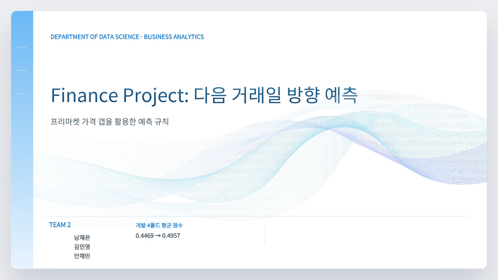
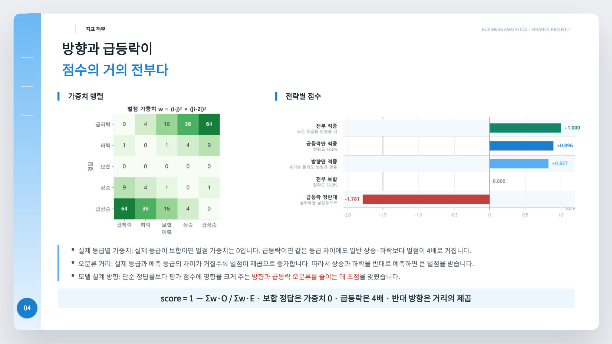
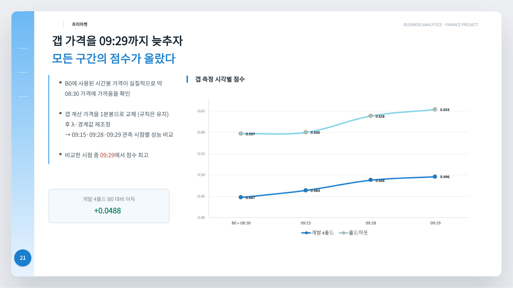
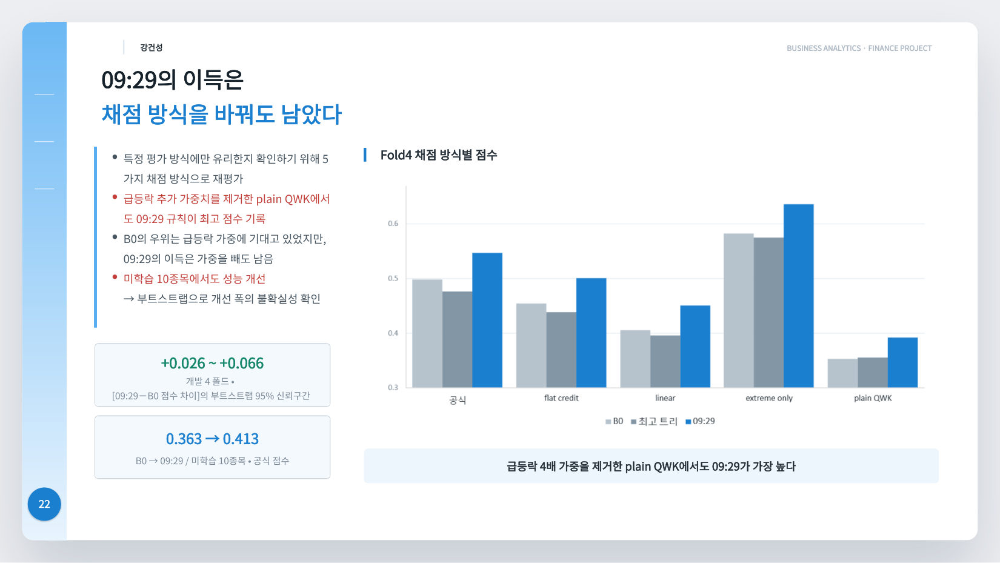
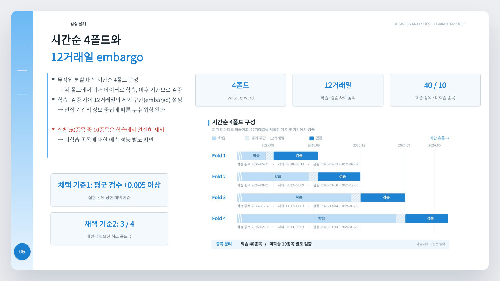
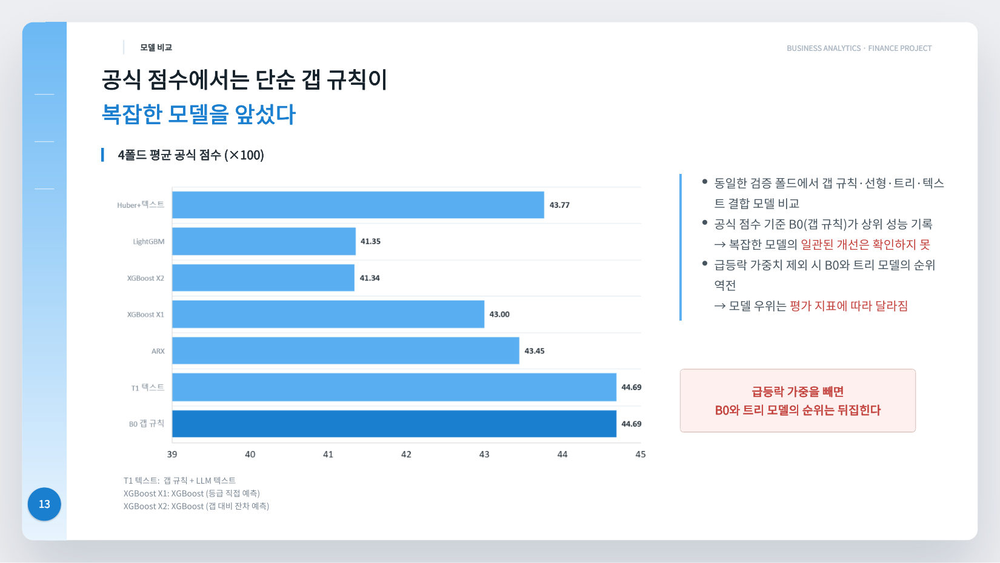
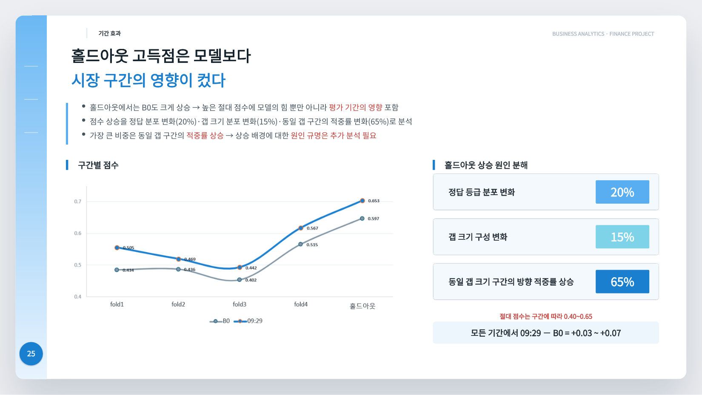

# 다음 거래일 주가 방향 예측

미국 주식 50종목의 **다음 거래일 종가 방향**을 개장(09:30) 전에 5등급으로 예측합니다. 2026년 2학기 Business Analytics 팀 프로젝트(3인)이고, 데이터와 평가 지표·채점 인터페이스의 정의는 과목에서 주어졌습니다.

최종 제출 모델은 **학습된 상수 5개짜리 고정 규칙 하나**이고, 그중 λ이 0으로 학습돼 실제로 작동하는 건 등급 경계 두 개뿐입니다. 저는 LightGBM·XGBoost·선형 모델·LLM 텍스트 피처까지 **96개 모델 실험**을 같은 검증 장치로 돌렸고, 어느 것도 기준 갭 규칙을 안정적으로 넘지 못했습니다. 성능은 모델을 키워서가 아니라 **예측 시점에 합법적으로 쓸 수 있는 가장 최신 가격을 찾아서** 나왔습니다.

| | |
|---|---|
| 기간 | 2026-09-29 ~ 10-14 (최종 발표) |
| 데이터 | 50종목 × 522거래일. 일봉·시간봉·뉴스·실적·애널리스트·Reddit + Alpaca 1분봉 |
| 최종 점수 | **홀드아웃 0.6534** (기준선 0.5967, 73거래일·3,650건) |
| 내 역할 | 팀 A — 평가 장치 전체, 모델 실험 96개, 오답·지표 분석, 제출본 통합·검증 |
| 규모 | 팀 실험 265개, 커밋 93개 중 52개, 테스트 84개 |
| 스택 | Python 3.11+, uv, pandas/pyarrow, LightGBM, XGBoost, scikit-learn, W&B, pytest |

## 발표 자료

[](docs/presentation/final/final_deck.pdf)

**[최종 발표 PDF (28쪽, 2026-10-14)](docs/presentation/final/final_deck.pdf)** · 제가 10/06에 만든 A 파트 분석 발표는 [docs/presentation/](docs/presentation/) · 실행 방법은 [docs/RUN.md](docs/RUN.md)

아래 본문에 발표의 핵심 쪽을 함께 실었습니다.

---

## 1. 문제: 지표가 한쪽으로 몰아 찍는 걸 막는다

평가 지표는 단순 정확도가 아니라 **우연 보정 가중 점수**입니다 ([`src/data.py`](src/data.py)).

```
score = 1 − Σ w·O / Σ w·E       O: 실제 혼동행렬, E: 같은 예측 비율로 무작위로 찍은 기대치
```

0이 기준선이라 **한 클래스만 계속 찍으면 정확히 0점**입니다. 정답이 보합인 행은 가중 0, 급등락인 행은 4배이고, 틀린 거리는 제곱으로 깎입니다. 그래서 점수는 **크게 움직인 날 방향을 맞혔느냐**로 거의 정해집니다.



## 2. 결과: 갭 가격의 시각을 당길수록 점수가 오른다

같은 폴드·같은 지표입니다. 홀드아웃은 대상일 2026-06-01~09-14, 73거래일·3,650건이고 모델 선택에 쓰지 않았습니다.

| 모델 | 개발 4폴드 | 기준선 대비 | 홀드아웃 | 기준선 대비 |
|---|---:|---:|---:|---:|
| B0 — 갭 규칙 (기준선) | 0.4469 | — | 0.5967 | — |
| 프리마켓 09:15 | 0.4636 | +0.017 | 0.5996 | +0.003 |
| 프리마켓 09:28 | 0.4875 | +0.041 | 0.6381 | +0.041 |
| **프리마켓 09:29 (제출)** | **0.4957** | **+0.049** | **0.6534** | **+0.057** |



09:15는 개발에서 보인 이득이 홀드아웃에서 거의 사라졌고(+0.017 → +0.003), 09:28은 폭이 그대로 유지됐습니다(+0.041 → +0.041). 기준 갭 규칙과 같은 피처로 학습한 XGBoost는 bootstrap 2,000회 전부에서 그 규칙보다 낮았습니다([4-2](#xgboost-규제를-강하게-걸어도-규칙을-넘지-못했다)).

## 3. 핵심 발견: 모델이 아니라 시계를 당겼다

기준선 B0는 과목 데이터의 시간봉 중 예측 전에 쓸 수 있는 **마지막 봉(08:00 봉 종가, 실질적으로 약 08:30 가격)**으로 갭을 만듭니다. 09:00 봉은 `known_at`이 09:30이라 쓸 수 없습니다. 그래서 08:30부터 09:30까지 한 시간의 가격 움직임은 버려지고 있었습니다.

제출 모델은 갭 가격만 **대상일 09:29까지 끝난 마지막 1분봉**으로 바꿉니다. 수식은 그대로입니다.

```
gap_z = ((09:29까지 확정된 가격 / 전일 종가) − 1) / vol20     vol20 = 최근 20거래일 수익률 표준편차
label = gap_z 를 고정 경계 a≈0.0761, b≈0.2511 로 자른 값
```

**모델 구조는 한 줄도 바뀌지 않았습니다.** 같은 수식에 같은 파라미터 개수이고, 갭 가격을 재는 시각만 다릅니다.

누수가 아닌지가 핵심이라 따로 검증했습니다. 봉이 **끝난** 시각이 09:29 이하인 봉만 씁니다(마지막은 09:28 시작·09:29 종료). 저장된 **23,771행 전부**를 검사해 09:29 이후에 끝나는 봉이 0건임을 확인했습니다([`reports/premarket_submission_check.json`](reports/premarket_submission_check.json)).

이 이득은 지표의 성질에 기댄 것이 아닙니다. 급등락 4배 가중을 뺀 plain QWK를 포함한 다섯 가지 채점 방식 모두에서 09:29가 최고 트리 모델보다 개발 4폴드 평균 +0.037~+0.070 높았습니다.



## 4. 내가 한 일

프리마켓 갭 아이디어와 수집 코드는 팀원 김민영의 작업입니다([`work/b/`](work/b/)). 제 몫은 **그 아이디어가 진짜인지 판정할 수 있는 검증 장치**를 만들고, **그 장치로 다른 모든 모델을 실제로 시험해 본 것**, 그리고 최종 규칙을 제출 코드로 통합·검증한 것입니다.

### 4-1. 평가 장치 (10/01, [PR #1](https://github.com/chaelioness/Business_p1/pull/1))



- **시간순 4폴드** ([`lab/folds.json`](lab/folds.json), [`lab/cv.py`](lab/cv.py)): 확장 학습창, 폴드마다 검증 60거래일. 무작위로 섞으면 내일 데이터로 오늘을 학습하게 됩니다.
- **12거래일 embargo**: 실제 평가에서 공개 데이터 끝(9/14)과 평가 시작(10/1) 사이가 12거래일이라 같은 간격을 뒀습니다.
- **미학습 10종목**: BA, BKNG, CVS, GLW, NFLX, PFE, QCOM, RTX, TMO, WELL을 학습에서 빼고 따로 채점했습니다. 실제 평가 20종목 중 10종목이 새 종목이기 때문입니다.
- **누수 차단** ([`lab/leak.py`](lab/leak.py)): 모든 예측이 `guard(day)`를 거칩니다. 대상일 09:30 이후 정보를 읽으려 하면 점수 대신 오류가 납니다.
- **사전 채택 기준**: 실험 전에 정했습니다. 평균 +0.005 이상, 4폴드 중 3폴드 이상 개선, fold4 하락 없음. 10/11부터는 미학습 종목 비음수와 bootstrap 하한 > 0을 더했습니다.
- **실험 추적** ([`lab/tracking.py`](lab/tracking.py)): 모든 run을 W&B에 폴드별·월별·종목군별 점수와 혼동행렬로 남겼습니다.

### 4-2. 모델 실험 96개

모든 실험이 같은 폴드와 같은 점수 함수를 썼고, 한 번에 한 요소만 바꿨습니다. 아래 fold4 기준 규칙 점수는 **0.515**입니다.

| 날짜 | 묶음 | 수 | 바꿔 본 것 | 최고 fold4 | 판정 |
|---|---|---:|---|---:|---|
| 10/01 | 기준선 | 6 | 무작위 2종, 전부 보합, 어제 따라 하기, 장전 등락, 시간외 갭 | 0.511 | 하한선 |
| 10/03 | B 규칙 재구현 | 2 | 민영 규칙을 이 장치로 다시 구현 (제출 v1) | **0.515** | 기준 |
| 10/03 | LightGBM 디코딩 | 4 | 다항 LightGBM(피처 26개)의 확률 → 등급 변환만 교체 | 0.495 | 디코딩만으로 +0.062 |
| 10/03 | 텍스트 ablation | 4 | LightGBM에 뉴스·Reddit 피처 추가 | 0.494 | 오히려 −0.002~−0.025 |
| 10/03 | v2 선형·트리 | 12 | Ridge·Huber·로지스틱, LightGBM 회귀(L2·Huber·L1·순서형·가중 다항, gap_z 단조 제약) | 0.507 | 전부 미달 |
| 10/03 | v2 규칙+정보·앙상블 | 16 | 규칙에 사전 단어·TF-IDF·실적·atr14를 신뢰도·경계·방향 항으로 결합, 규칙+Huber 앙상블 | 0.517 | 노이즈 범위 |
| 10/04 | v3 갭·국면·학습 창 | 9 | 시장 갭 분리, 국면별 경계, 최근 250·120일 학습, 창 투표 | 0.522 | +0.007, 불확실 |
| 10/07 | LLM 피처 | 13 | 뉴스 v6·Reddit v4 LLM 피처를 규칙 경계·게이트·가산 항과 LightGBM에 | 0.517 | 채택 0 |
| 10/08 | 추가 실험 | 20 | 학습 창 자동 선택, bagging 30, VIX(CBOE 외부 데이터), 애널리스트 의견, 구조 모형, LLM 확실도, 비대칭 경계, LightGBM+텍스트 46개 | 0.521 | 채택 0 |
| 10/11~12 | 기대비용 디코딩 | 6 | LightGBM 출력을 점수식 가중으로 직접 디코딩 | — | 최선도 평균 −0.021 |
| 10/11~12 | 방향 보정 P1·T1 | 2 | 가격 경로·최신성 보정(로지스틱), 신규성 높은 날만 LLM 방향 사용 | — | P1 +0.0017(1/4폴드), T1 1차 선별 탈락 |
| 10/12 | XGBoost | 2 | 단조 제약·강한 규제, 프리마켓 피처 유무 | — | 같은 피처는 bootstrap 2,000회 전부 기준선 미달 |


10/06까지의 53개를 정리한 그림입니다. 무엇을 붙여도 B 규칙(초록 점선) 근처에서 멈췄습니다. 팀 전체로는 265개 실험을 같은 폴드와 같은 점수 함수로 비교했습니다(발표 12쪽).



#### XGBoost: 규제를 강하게 걸어도 규칙을 넘지 못했다

`max_depth=2`, `min_child_weight=100`, `reg_lambda=20`에 갭 방향 단조 제약까지 걸었습니다. 아래는 **09:15 기준, 홀드아웃을 열지 않은** 개발 4폴드 비교입니다(대상일 2024-08-14~2026-05-28, 448일).

| 모델 | fold1 | fold2 | fold3 | fold4 | 평균 | 미학습 종목 |
|---|---:|---:|---:|---:|---:|---:|
| B0 (기준선) | 0.4344 | 0.4356 | 0.4020 | 0.5154 | 0.4469 | 0.3634 |
| B0 + 프리마켓 09:15 — 규칙 | 0.4696 | 0.4244 | 0.4113 | 0.5492 | **0.4636** | **0.3758** |
| XGBoost, 같은 피처 | 0.4341 | 0.3981 | 0.3812 | 0.5065 | 0.4300 | 0.3448 |
| XGBoost + 프리마켓 피처 | 0.4706 | 0.4077 | 0.3956 | 0.5160 | 0.4475 | 0.3479 |

기준선 대비 bootstrap (5거래일 블록, 2,000회, seed 2026)

| 모델 | 평균 차이 | 95% 구간 | 0 이하 비율 |
|---|---:|---:|---:|
| B0 + 프리마켓 09:15 — 규칙 | **+0.0170** | [−0.0055, +0.0385] | 6.8% |
| XGBoost, 같은 피처 | −0.0179 | [−0.0275, −0.0090] | **100%** |
| XGBoost + 프리마켓 피처 | +0.0003 | [−0.0236, +0.0227] | 48.3% |

같은 피처의 XGBoost는 2,000회 **전부**에서 기준선보다 낮았고, 프리마켓 피처를 줘도 48.3%로 동전 던지기 수준이었습니다. 같은 정보를 준 두 경우 모두 평균은 규칙이 높았습니다(0.4469 vs 0.4300, 0.4636 vs 0.4475). 설정은 [`config.json`](reports/xgb_premarket/config.json), 전체 표는 [`REPORT.md`](reports/xgb_premarket/REPORT.md), 코드는 [`scripts/xgb_premarket_study.py`](scripts/xgb_premarket_study.py)에 있습니다.

<details>
<summary><b>묶음별 실험 세부</b></summary>

- **LightGBM 디코딩 (10/03).** 같은 다항 LightGBM에서 확률을 등급으로 바꾸는 방법만 argmax → 학습 분포 맞춤 → 공격적 디코딩으로 바꿨더니 fold4가 0.433 → 0.495로 올랐습니다. 모델 종류보다 "어떻게 찍느냐"가 컸습니다. argmax는 보합을 37% 찍어 점수식에서 손해를 봅니다.
- **v2 (10/03).** 손실 함수를 L2·Huber·L1·순서형 근사·가중 다항으로 바꾸고, 목표를 등급 대신 `수익률 / vol20` 회귀로 바꾸고, 단조 제약을 걸었습니다. LLM 없이 만든 사전 단어 수와 TF-IDF 피처도 넣었습니다. 최고는 Huber 선형 0.507, 규칙+atr14 경계 0.517이었습니다.
- **v3 (10/04).** 시장 전체 갭과 종목 고유 갭을 분리(κ)하고, 장전 등락을 섞고(θ), 시장 변동성·종목 급등락 빈도에 따라 경계를 바꾸고, 최근 250·120일로만 학습했습니다. 최고는 `v3_winvote` 0.522, 다음이 `v3_recent250` 0.521이었습니다. recent250과 규칙의 차이를 날짜 bootstrap으로 보면 95% 구간이 −0.002~+0.014, 0 이하 확률 9%였고, 월별로는 3월은 같고 4·5월에만 올랐습니다. 구분할 수 없는 차이라 보류했습니다.
- **LLM 피처 (10/07).** 안채민이 만든 뉴스 v6·Reddit v4 구조화 피처를 규칙의 급등락 경계, 반대 방향 게이트, 방향 가산 항, LightGBM 피처로 붙였습니다. 13개 중 채택 기준을 넘은 것은 없었습니다. 규칙에 붙인 최선은 fold4 +0.0012였고, LightGBM에 넣은 경우는 fold4에서 규칙보다 0.011~0.026 낮았습니다.
- **추가 20개 (10/08).** CBOE의 VIX 종가를 외부 데이터로 들여와 경계에 넣었고(fold4 +0.0057, 그러나 1폴드만 개선), 수익률 = (1−ρ)·갭 + 잡음 구조 모형, 급상승·급하락 경계 분리, 뉴스·Reddit 방향과 갭 부호가 일치하는 정도(확실도)도 시험했습니다. 채택 0개입니다.
- **방향 보정 (10/11~12).** P1은 갭이 만들어진 경로와 최신성으로 방향을 보정했습니다. 그런데 최신성 피처가 이 자료에서 거의 상수였습니다(경과 시간이 정확히 30분인 행 99.4%). 그래서 이 가설은 기각된 게 아니라 **이 자료로는 검증할 수 없는 가설**로 남겼습니다.

전체 표는 [`docs/presentation/experiment_table.md`](docs/presentation/experiment_table.md), 과정은 [`docs/worklog/`](docs/worklog/)에 있습니다.

</details>

### 4-3. 왜 복잡한 모델이 못 넘었나

실험이 안 올랐다는 결과보다, **왜 안 오르는지**를 숫자로 확인하는 데 시간을 더 썼습니다.


- **벌점의 절반이 3%에서 나온다.** fold4 규칙 벌점의 51%가 3,000행 중 96행, 즉 크게 움직인 날 방향을 반대로 찍은 행에서 나왔습니다. 갭이 작아서 틀린 게 아니라(|gap_z| 중앙값 0.26, 전체 0.24), 아침엔 한쪽으로 가 있다가 장중에 뒤집힌 날들입니다.
- **크기만 알고 방향을 모르면 크게 찍는 건 손해다.** 규칙이 '상승'으로 찍은 575행을 전부 '급상승'으로 올리자 점수가 0.515 → 0.494로 떨어졌습니다. 그래서 변동성·실적·뉴스 양 같은 **크기 신호**는 학습 데이터가 덜 쓰는 쪽을 골랐습니다.
- **트리 모델도 규칙과 같은 것을 배웠다.** LightGBM 예측을 피처별 몫으로 쪼개 보니(`pred_contrib`, SHAP와 같은 방식을 패키지 없이 계산) 방향은 gap·gap_z·gap_rel_z가 거의 전부였고, 크기는 atr14·|gap_z|였습니다. 규칙의 "갭 ÷ 변동성" 구조를 다시 배운 셈입니다. 텍스트 7개를 다 넣어도 기여 몫은 4.8%였습니다.


- **갭을 섞으면 무너진다.** 갭 정보를 5거래일 블록 단위로 섞으면 점수가 −0.396 떨어졌습니다. ALE·ICE에서도 갭이 커질수록 등급이 단조롭게 올랐습니다.
- **LLM은 갭에 방향 정보를 더하지 못했다.** LLM이 방향을 낸 3,570행에서 갭의 방향 적중률은 66.5%, LLM은 52.3%였습니다. 둘이 엇갈린 날 LLM이 맞은 비율은 34.4%였습니다.
- **구분할 수 있는 차이의 하한을 쟀다.** 무작위로 1,000번 찍으면 fold4 점수의 표준편차가 0.029입니다. 의미 없는 가짜 피처로 같은 절차를 30번 돌리자 28번이 "안 씀"을 골랐고 최대 +0.002가 나왔습니다. 그래서 +0.005 미만의 차이는 실력으로 보지 않았습니다.
- **디코딩이 지표를 속이는 경우를 잡았다.** 기대비용 디코딩 중 `ratio` 방식은 같은 LightGBM의 기존 디코딩보다 공식 점수가 +0.012 올랐는데, 정확도는 0.302 → 0.231로 떨어졌습니다. 매일 50종목 중 33%를 급하락으로 찍어 점수식 분모(무작위 기대 벌점)를 부풀린 결과였습니다. 반대로 `cost` 방식은 정확도 0.378, 방향 반대 11.7%로 예측 품질은 1위였지만 보합을 60.8% 찍어 공식 점수는 최하위 0.346이었습니다. 사전 채택 기준이 둘 다 걸러냈습니다.
- **"B0가 더 좋은 모델"이 아니라 "이 지표에서 가장 낫다".** 공식 점수 외 네 가지 자로 다시 채점하니, 급등락 가중을 뺀 plain QWK에서 B0와 최고 트리의 순위가 −0.0018로 뒤집혔습니다. 발표에서 이 표현을 바로잡았습니다.
- **재현.** 기록 없이 같은 폴드로 다시 돌린 42개 run 전부 W&B 기록과 같은 점수가 나왔습니다(최대 차이 0.00000).

### 4-4. 제출본 통합과 검증 (10/12~13)

- 민영의 프리마켓 규칙을 채점 경로 [`src/model.py`](src/model.py)에 통합하고, 홀드아웃 1회 검사를 거쳐 제출 시각을 09:28에서 09:29로 옮겼습니다.
- **캐시 검증** (`_read_premarket_cache`): 프리마켓 파일에서 열 누락·종목 중복·가격 이상·09:29 이후 시각 행을 거르고, 걸린 종목만 B0 입력으로 대체합니다. 파일이 없어도 오류 없이 예측합니다.
- 누락된 종목만 다시 받고, 실패하면 기존 캐시를 보존한 채 종료 코드 1을 반환하도록 수집 경로를 고쳤습니다.
- 제출 전 검사: 제출 코드 = 민영 규칙 3,000행 일치, 파일이 없을 때 = B0 1,000행 일치, 09:29 이후 봉 0건(23,771행), 압축 파일 안 API 키 문자열 0건.

### 4-5. 담당 범위

| 영역 | 내용 |
|---|---|
| [`lab/`](lab/) | 폴드 정의, 교차검증, 누수 차단, 기준선, 실험 추적 (9개 전부) |
| [`src/`](src/) | 채점 인터페이스, 지표 구현, 피처, 제출 모델 (9개 중 8개) |
| [`scripts/`](scripts/) | 실험·분석 스크립트 36개 전부 (XGBoost, LightGBM, 디코딩, 지표 민감도, W&B 백필) |
| [`tests/`](tests/) | 누수·지표·모델·추적·캐시 검사 (9개 중 8개) |
| [`docs/worklog/`](docs/worklog/) | 실험 일지 15편 — 방법·이유·결과·기각 근거 |
| [`docs/presentation/`](docs/presentation/) | A 파트 분석 발표, 검증표, 그림 |

프로젝트 기간 커밋(merge 제외) 93개 중 52개입니다.

## 5. 재현성

- 의존성은 `uv.lock`으로 고정합니다. `uv sync --locked`
- 테스트 84개. 로컬에만 있는 산출물이 없으면 필요한 파일 이름을 밝히며 건너뜁니다.
- 제출 파라미터는 [`artifacts/premarket_rule.json`](artifacts/premarket_rule.json), 산출 근거와 입력 해시는 [`premarket_rule.provenance.json`](artifacts/premarket_rule.provenance.json)에 있습니다.
- 모든 실험 run은 W&B `BI_finance_project/finance-direction`, LLM 호출 추적은 Weave `finance-llm`에 있습니다.
- 예측할 때는 재학습·외부 API·LLM 호출이 없습니다. 프리마켓 파일이 없으면 그 종목만 B0 입력으로 대체합니다.

## 6. 한계



- **홀드아웃 고득점은 모델보다 구간 효과입니다.** B0도 0.447 → 0.597로 같이 올랐습니다. 원인을 분해해 보면 65%가 같은 크기의 갭에서도 방향을 더 잘 맞힌 데서 왔습니다. 0.6534를 일반적인 기대 성능으로 읽으면 안 됩니다.
- **홀드아웃이 완전히 손대지 않은 검증은 아닙니다.** 09:28까지는 표본 밖 1회 검사였지만, 09:28과 09:29 중 09:29를 고를 때는 홀드아웃 점수를 같은 표에 놓고 봤습니다.
- 09:28은 방향 적중률이 기준선보다 낮고(0.69 → 0.66) 보합 비율이 두 배입니다(0.076 → 0.15). "확신 없는 날을 보합으로 빼서" 크게 틀릴 날을 줄였다고 추정하지만 검증하지 않았습니다.
- 09:29 가격을 개장 전에 실시간으로 받으려면 유료 피드가 필요합니다. 못 받으면 B0로 대체되고 이득 약 0.05를 잃습니다.
- 비공개 10월 평가 결과는 아직 받지 못했습니다. 위 숫자는 모두 공개 구간 기록입니다.

## 7. 저장소 둘러보기

```text
src/                채점 인터페이스, 지표, 피처, 제출 모델
lab/                폴드·교차검증·누수 차단·기준선·실험 추적      ← 평가 장치
scripts/            실험·분석 스크립트 36개
reports/            실험 결과 (XGBoost bootstrap, 지표 민감도, 기각 판정)
artifacts/          제출 파라미터 + 산출 근거
docs/presentation/  최종 발표 PDF, A 파트 분석 발표, 실험 검증표
docs/worklog/       실험 일지 15편
docs/RUN.md         채점용 실행 안내
tests/              84개 — 누수, 지표, 캐시 검증, 모델
work/a b c/         팀별 작업 (a: 남재은, b: 김민영, c: 안채민)
```

## 8. 팀

| | 담당 |
|---|---|
| **남재은** (나) | 평가 장치, 모델 실험 96개(LightGBM·XGBoost·선형·LLM 피처 결합), 오답·지표 분석, 제출본 통합·검증 |
| 김민영 | 갭 규칙(B0)과 프리마켓 1분봉 수집·09:29 규칙 — 최종 제출 모델의 핵심 |
| 안채민 | Gemini 기반 뉴스(v6)·Reddit(v4) 구조화 파이프라인 — 뉴스 26개·Reddit 20개 피처 |

원 저장소는 [chaelioness/Business_p1](https://github.com/chaelioness/Business_p1)입니다.
