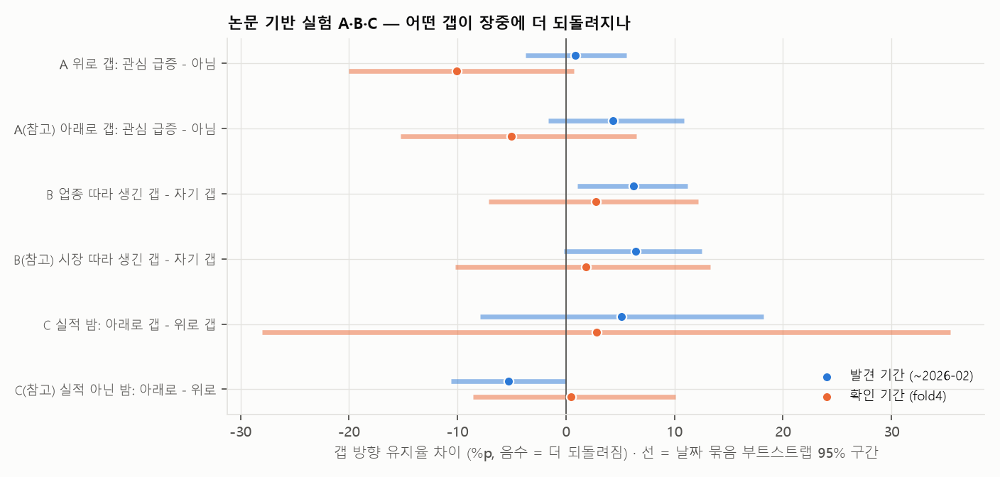

# 논문 기반 실험 — 어떤 갭이 장중에 더 되돌려지나

> 선행 연구에서 "밤사이 움직임이 장중에 되돌려지는 조건" 세 가지를 골라 우리 데이터로 확인했습니다.
> **분석용**입니다. 홀드아웃이 이미 열렸으므로 이 결과로 제출 모델을 바꾸지 않습니다. 기준은 실행 전에 스크립트 맨 위에 고정했습니다.

작성 2026-10-10 · 민영(B) · 코드: [papers/papers.py](../../work/b/review/papers/papers.py)

**공통 설정**
- 대상: |gap_z| ≥ 0.25 인 행. 지표는 **갭 방향 유지율** = 09:00 이후 움직임이 갭과 같은 방향인 비율 (낮을수록 장중에 되돌려짐)
- 발견 기간 = 대상일 ~2026-02-12, 확인 기간 = fold4 val
- 통과 = 발견 기간에서 논문이 예측한 방향 + 날짜 묶음 부트스트랩 95% 구간이 0 을 안 걸침 + 확인 기간 같은 부호

---

## 3줄 요약

1. **세 실험 모두 논문의 예측대로 나오지 않았습니다.** 통과 0.
2. **B 는 오히려 반대였습니다:** 업종 따라 생긴 갭(자기 뉴스 없음)이 자기 갭보다 **덜** 되돌려집니다 (+6.2%p, 구간이 0 을 안 걸침, 확인 기간도 같은 방향). 즉 **혼자 튄 갭이 더 되돌려집니다** — B 10/3 문서의 "혼자 튄 갭일수록 되돌려짐"과 같은 결과입니다.
3. 우리 50종목은 대형주라, 개인투자자 관심·가치평가 어려움 때문에 생기는 되돌림(논문들의 설명)이 약한 것으로 보입니다.

---

## 결과

| 실험 | 논문 (예측) | 기간 | 유지율 A | 유지율 B | 차이 [95% 구간] | 통과 |
|---|---|---|---:|---:|---|:---:|
| **A** 위로 갭: 관심 급증 vs 아님 | Berkman et al. 2012 (급증이 더 되돌려짐, 차이 < 0) | 발견 | 48.3% (776) | 47.4% (3,640) | +0.9%p [−3.7, +5.6] | ❌ |
| | | 확인 | 38.1% (118) | 48.2% (658) | −10.0%p [−20.0, +0.7] | |
| A(참고) 아래로 갭 | | 발견 | 46.3% | 42.0% | +4.3%p [−1.6, +10.8] | – |
| | | 확인 | 42.7% | 47.7% | −5.1%p | |
| **B** 업종 따라 생긴 갭 vs 자기 갭 | Wang 2025 (남 따라 생긴 갭이 더 되돌려짐, 차이 < 0) | 발견 | 50.0% (642) | 43.8% (4,871) | **+6.2%p [+1.1, +11.2]** | ❌ (반대 방향) |
| | | 확인 | 50.0% (142) | 47.2% (800) | +2.8%p [−7.1, +12.2] | |
| B(참고) 시장 따라 생긴 갭 vs 자기 갭 | | 발견 | 50.7% | 44.2% | +6.5%p [−0.2, +12.5] | – |
| | | 확인 | 49.0% | 47.2% | +1.8%p | |
| **C** 실적 밤: 아래로 갭 vs 위로 갭 | UWA (나쁜 뉴스에 과잉반응, 차이 < 0) | 발견 | 55.8% (129) | 50.7% (144) | +5.1%p [−7.9, +18.2] | ❌ |
| | | 확인 | 60.0% (20) | 57.1% (28) | +2.9%p [−28.0, +35.4] | |
| C(참고) 실적 아닌 밤: 아래로 vs 위로 | | 발견 | 42.2% | 47.5% | −5.3%p [−10.6, 0.0] | – |
| | | 확인 | 46.7% | 46.3% | +0.5%p | |

괄호 안은 행 수. 관심 급증 = 밤사이 태그 기사 수 또는 Reddit 언급 글 수가 그 종목 직전 20일 평균보다 많이 늘어난 날 (발견 기간 상위 10% 기준, 전체의 17%). 업종 따라 생긴 갭 = 같은 업종 다른 종목들의 평균 갭과 같은 방향이고 차이가 갭의 절반 미만, 그리고 제목에 기업명이 나온 기사 없음.

---

## 읽을 거리

**A. 관심이 몰린 종목 (Berkman et al. 2012)**
- 발견 기간에는 차이가 없고(+0.9%p), fold4 에서만 관심 급증 종목의 위로 갭이 더 되돌려졌습니다(−10%p). 한 기간에서만 나타나 판정 기준을 못 넘습니다.
- 논문은 소형주·개인투자자 비중이 큰 종목에서 효과가 크다고 했는데, 우리 50종목은 모두 대형주입니다.

**B. 시장·업종 따라 생긴 갭 (Wang 2025) — 반대 결과**
- 논문은 "동종 기업 때문에 오른 갭은 장중에 되돌려진다"고 했지만, 우리 데이터에서는 **업종·시장과 같이 움직인 갭이 더 유지**되고, **혼자 튄 갭이 더 되돌려졌습니다.**
- 이건 사전에 예측한 방향이 아니라서 "통과"로 치지 않지만, 두 기간에서 같은 방향이고 B 10/3 문서의 관찰("갭 이후 남은 움직임은 혼자 튄 갭일수록 되돌려짐, 순위상관 −0.09")과도 같습니다.
- 다만 A(재은)의 v3 실험에서 시장 갭을 빼는 보정(κ)은 train 이 0 을 골랐습니다. 되돌림 경향은 있지만 지금 규칙의 경계가 이미 반영하고 있어서 점수로는 안 바뀐 것으로 보입니다.

**C. 나쁜 뉴스 과잉반응 (UWA)**
- 실적 밤에는 아래로 갭이 오히려 더 유지됐습니다(+5.1%p, 표본이 작아 구간이 넓음). 과잉반응 예측과 반대입니다.
- 실적이 아닌 밤에는 아래로 갭이 조금 더 되돌려지는 경향(−5.3%p, 구간이 0 에 걸침)이 있었지만 확인 기간에는 없었습니다.
- 09 문서에서도 위로·아래로 갭의 정반대 오답 비율은 2.7% 로 같았습니다.

---

## 발표에 쓸 문장

> "선행 연구(Berkman 2012, Wang 2025 등)가 보고한 '밤사이 움직임의 장중 되돌림' 조건을 우리 데이터로 확인했다. 관심 급증·나쁜 뉴스 조건은 재현되지 않았고, 업종을 따라 생긴 갭은 오히려 더 유지됐다. 대형주 50종목에서는 개인투자자 관심으로 생기는 되돌림이 약해, 갭이 이미 정보를 잘 반영하는 것으로 보인다."

- 09 문서의 "큰 벌점은 장중 반전"과 함께 쓰면, **"되돌림은 있지만 아침에 어떤 갭이 되돌려질지 미리 알 조건은 못 찾았다"** 는 흐름이 됩니다.

---

참고 논문

- Berkman, Koch, Tuttle, Zhang (2012), "Paying Attention: Overnight Returns and the Hidden Cost of Buying at the Open", *JFQA* 47(4)
- Wang (2025), "Decoding Spillover", *JFQA* (동종 기업 밤사이 수익률 전이와 장중 되돌림)
- "The Timing of Information Arrival and Overnight Returns", University of Western Australia (시간외 뉴스의 과소·과잉 반응). 저자·연도는 원문 확인 필요
- 관련: Lou, Polk, Skouras (2019) *JFE*, Aboody et al. (2018) *JFQA*, Jiang, Likitapiwat, McInish (2012) *JFQA*

재현 방법

- 실행: `uv run python work/b/review/papers/papers.py` (몇 분)
- 준비: `cache/llm_reddit_v4/daily_features.csv` (채민 Reddit v4, 후보 글 수만 사용), `cache/gapz_rule.parquet`, `dataset/news.parquet`
- 업종: 50종목을 공개된 GICS 업종으로 스크립트 안에 고정 (`SECTOR`)
- 결과 CSV: `papers/out/` (git 에 안 올림)

