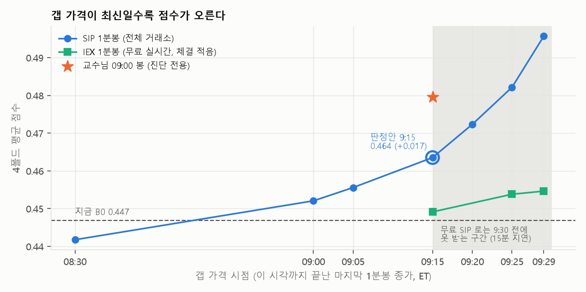
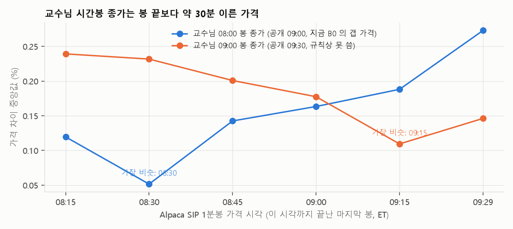

# 프리마켓 분봉 — 갭 가격을 9:15 가격으로

> 외부 데이터(Alpaca 시장 데이터, 무료 계정)의 1분봉으로 **갭 가격만 더 최신으로** 바꿨습니다. B 리뷰 실험 80여 개 중 **처음으로 채택 기준을 통과**했습니다.
> 숫자는 모두 dev 4폴드 기준입니다. 홀드아웃은 이미 한 번 열렸으므로 다시 보지 않았습니다. **제출 모델은 아직 B0 그대로**입니다(채택은 팀 결정).

작성 2026-10-11 · 민영(B) · 후보 규칙: [premarket_rule.py](../../work/b/features/premarket_rule.py) · 검사: [check_premarket_rule.py](../../work/b/features/check_premarket_rule.py) · 실험: [work/b/review/premarket/](../../work/b/review/premarket/)

---

## 3줄 요약

1. **갭 가격을 9:15에 확정된 1분봉 가격으로 바꾸면 0.447 → 0.464 (+0.017).** 3/4 폴드 상승, fold4 +0.033, 처음 보는 종목 +0.013입니다. 실행 전에 정한 기준을 통과했습니다.
2. **교수님 시간봉의 "종가"는 실제로 봉 끝보다 약 30분 이른 가격입니다.** 08:00 봉 종가 ≈ 8:30 가격, 09:00 봉 종가 ≈ 9:15 가격. 그래서 지금 B0의 갭은 사실상 8:30 가격이고, 9:15는 그보다 45분 더 최신입니다.
3. **가격 외 정보는 여전히 효과가 없습니다.** 무료 실시간 IEX, 시장(SPY·QQQ) 움직임, 프리마켓 거래량은 모두 기준 미달입니다. 정보는 결국 "가장 최신 가격"에 있습니다.

---

## 왜 했나

- 09 문서와 재은 2차 ⑥: 점수를 잃는 곳의 77%가 **방향 오답**입니다. 경계를 아무리 다듬어도 최대 +0.03이고, 방향을 다 맞히면 +0.4입니다.
- 텍스트(뉴스·LLM·Reddit)는 방향을 못 줬습니다(06 문서 46~51%, 재은 ⑦ 52%). 공개 정보는 이미 가격에 반영돼 있기 때문입니다.
- 그래서 남은 방향 정보는 **"우리 갭보다 더 최신 가격"** 뿐이라고 봤습니다. 교수님 데이터의 09:00 봉(공개 시각 = 9:30 = cutoff라 규칙상 못 씀)을 **진단으로만** 넣어 보니 4폴드 +0.033(4/4 폴드 상승)이었습니다. 외부 분봉을 구할 가치가 있다고 판단했습니다.

## 규칙 해석 (look-ahead)

- 과제 기준은 **"대상일 9:30 미만에 실제로 이용 가능했던 데이터"** 입니다. 9:00까지로 끊으라는 뜻이 아닙니다(팀원 확인).
- 분봉도 **봉 완성 + 피드 지연까지 9:30 전**이어야 합니다.
  - Alpaca 분봉 시각은 봉 **시작** 기준 → "봉 끝 ≤ 기준 시각"인 봉만 씁니다.
  - 무료 요금제의 SIP(전체 거래소) 데이터는 **최근 15분 지연** → 판정은 **9:15에 확정된 가격**으로만 합니다. 9:30 전에 받을 수 있는 값입니다.
- 저장 파일에는 9:15 이후 가격이 아예 없습니다. 검사 스크립트가 20,555행 모두 "마지막 봉 끝 ≤ 9:15"임을 확인합니다.

---

## 결과

### 1. 시점별 (판정 = 9:15, 실행 전 고정)

| 갭 가격 | fold1 | fold2 | fold3 | fold4 | **평균** | B0 대비 | 처음 보는 종목 | 방향 적중 |
|---|---:|---:|---:|---:|---:|---:|---:|---:|
| 지금 B0 (교수님 08:00 봉) | 0.434 | 0.436 | 0.402 | 0.515 | 0.447 | – | 0.363 | 68.2% |
| 분봉 08:30 (B0와 같은 시점) | 0.439 | 0.420 | 0.394 | 0.514 | 0.442 | −0.005 | 0.353 | 67.6% |
| 분봉 09:00 | 0.457 | 0.419 | 0.400 | 0.532 | 0.452 | +0.005 | 0.373 | 68.9% |
| 분봉 09:05 | 0.467 | 0.409 | 0.403 | 0.543 | 0.456 | +0.009 | 0.375 | 69.5% |
| **분봉 09:15 (판정)** | **0.470** | 0.424 | **0.411** | **0.549** | **0.464** | **+0.017** | **0.376** | 69.0% |
| 분봉 09:20 (참고) | 0.487 | 0.426 | 0.419 | 0.557 | 0.472 | +0.025 | 0.382 | 71.1% |
| 분봉 09:25 (참고) | 0.483 | 0.456 | 0.424 | 0.566 | 0.482 | +0.035 | 0.399 | 70.1% |
| 분봉 09:29 (참고) | 0.505 | 0.469 | 0.442 | 0.567 | 0.496 | +0.049 | 0.413 | 71.7% |
| 교수님 09:00 봉 (진단 전용) | 0.498 | 0.437 | 0.428 | 0.555 | 0.480 | +0.033 | 0.391 | 70.8% |

λ·a·b 는 폴드마다 train 으로 다시 고름. 분봉이 없는 행(약 12~16%)은 B0 갭으로 채움.

**판정 (9:15):** 평균 +0.017 (기준 +0.005), 3/4 폴드 상승(fold2 −0.012), fold4 +0.033 → **통과**

- 9:20 이후는 실시간 SIP(유료, 월 $99)가 있어야 9:30 전에 받을 수 있어서 **참고로만** 둡니다. 비용 때문에 쓰지 않기로 했습니다.
- 분봉 08:30이 B0와 비슷하게 나오는 것(−0.005)은 아래 2번 발견을 뒷받침합니다. 같은 시점 가격이면 점수도 같습니다. 남은 차이는 데이터 출처와 커버리지 차이입니다.

### 2. 교수님 시간봉 종가는 실제로 몇 시 가격인가

| Alpaca 가격 시각 | 교수님 08:00 봉 종가와 차이 | 교수님 09:00 봉 종가와 차이 |
|---|---:|---:|
| 08:15 | 0.12% | 0.24% |
| **08:30** | **0.05%** | 0.23% |
| 08:45 | 0.14% | 0.20% |
| 09:00 | 0.16% | 0.18% |
| **09:15** | 0.19% | **0.11%** |
| 09:29 | 0.27% | 0.15% |

대상일 4일에 1일 표본, 종목·날짜별 |가격 비 − 1| 의 중앙값.

- 봉 이름(08:00, 09:00)과 공개 시각(09:00, 09:30)을 보면 "봉 끝 가격"일 것 같지만, 실제로는 **약 30분 이른 가격**입니다. 팀원이 말한 "30분~1시간 가용 지연"과 맞습니다.
- 교수님 데이터만 쓰는 한 이건 문제가 아닙니다(공개 시각을 지키면 됨). 다만 **"갭 = 9시 가격"이라고 설명하면 틀립니다.** 정확히는 "갭 = 약 8:30 가격"입니다.

### 3. 왜 오르나

- 9:00~9:30 움직임은 작지만(vol20의 0.13배), **갭과 같은 방향은 41%뿐**입니다. 장중 되돌림이 개장 전부터 이미 시작됩니다.
- 최신 가격을 쓰면 되돌려지기 시작한 애매한 갭이 작아집니다. 그래서 급등락으로 덜 찍고 방향 적중이 올라갑니다.
- 09 문서의 "급등락 정반대" 오답 일부는 **9:30 전에 이미 신호를 보이고 있었다**는 뜻입니다.

### 4. 더 해 본 것 (모두 미달)

**무료 실시간 IEX 피드** (9:15보다 늦은 가격을 무료로 쓸 수 있나)

| 설정 | 평균 | B0 대비 |
|---|---:|---:|
| SIP 9:15 (판정안) | 0.464 | +0.017 |
| 무료 혼합: IEX 9:29 → 없으면 SIP 9:15 | 0.465 | +0.018 |
| IEX 9:29 단독 | 0.455 | +0.008 |

- 기준(혼합이 SIP 9:15보다 +0.005, 3폴드 이상): +0.001, 2/4 → **미달**
- IEX는 거래소 하나라 프리마켓 체결이 거의 없습니다. 9:29 전 가격이 있는 행이 **8.8%** 뿐이고, 그중 59%는 마지막 체결이 9:20 이전입니다.

**9:15 규칙 위에 시장·거래량 더하기** (가짜 피처 각 10개와 비교)

| 피처 | 형태 | 평균 | 상승 폴드 | 결과 |
|---|:---:|---:|:---:|---|
| 시장 움직임 (SPY·QQQ 8:30→9:15) | D | 0 | 0 | train 이 전부 0 을 고름 |
| | T | +0.004 | 3 | fold4 하락 |
| | S | −0.004 | 1 | 손해 |
| **시장이 갭과 같은 방향** | T | **+0.0044** | 3 | **아깝게 미달** (+0.005 기준, 가짜 95 분위 +0.003 은 넘음) |
| | S | −0.001 | 1 | 손해 |
| 프리마켓 거래량 이상치 | T | +0.002 | 2 | 미달 |
| | S | +0.002 | 2 | 미달 |

- 시장 방향을 따로 더하는 건(D) 의미가 없습니다. 종목의 9:15 가격에 그때까지의 시장 움직임이 이미 들어 있습니다.
- "시장과 같은 방향의 갭은 더 믿는다"는 기준에 0.0006 모자랐습니다. 방향은 13 문서 B(혼자 튄 갭이 더 되돌려짐)와 같습니다. train 이 네 폴드 모두 격자 끝값(0.4)을 골랐지만, 결과를 보고 격자를 넓히는 건 사후 조정이라 하지 않았습니다.
- 그래서 업종 ETF 분봉은 받지 않았습니다(사전 등록: 위에서 하나라도 채택될 때만).

---

## 후보 규칙 (`work/b/features/premarket_rule.py`)

`gapz_rule.py`(지금 제출 규칙 B0) 옆에 둔 **제출 후보**입니다. 규칙은 B0와 같고 갭 가격만 다릅니다.

| 함수 | 하는 일 |
|---|---|
| `fetch(targets, symbols, store)` | **사전 단계(인터넷·키 필요).** 대상일마다 08:00~09:15 SIP 1분봉을 받아 종목당 한 줄(px_0830, px_0915, 마지막 봉 시각, 거래량)로 줄여 저장. 원본 분봉·9:15 이후 가격은 저장 안 함. 키가 없으면 아무것도 안 함 |
| `build_gapz_pm(day, store)` | **오프라인.** 저장 파일이 있으면 9:15 가격으로 갭 계산. 파일이 없거나, 종목이 빠졌거나, 단위 확인(px_0830 vs 교수님 08:00 봉 종가)이 2% 넘게 어긋나면 **B0 갭 그대로** |
| `fit` / `predict` | `gapz_rule` 과 같음 |

- 저장 위치: `artifacts/premarket/` (git 제외). 키: 환경변수 `APCA_API_KEY_ID`, `APCA_API_SECRET_KEY`
- numpy·pandas·json·표준 라이브러리만 씁니다. `src/model.py` 의 "예측은 외부 호출 안 함" 원칙이 그대로 지켜집니다(인터넷은 사전 단계에서만).

**검사 결과** (`check_premarket_rule.py`)

| 검사 | 결과 |
|---|---|
| 이틀을 새로 받아 줄인 값 vs 캐시를 줄인 값 | 차이 0 |
| look-ahead: 저장된 마지막 봉 끝 ≤ 대상일 9:15 (20,555행) | 위반 0 |
| 분봉이 없을 때 B0 와 같은가 (`guard` 아래) | 차이 0 |
| 분봉을 안 쓴 행의 갭 = B0 갭 | True |
| 4폴드 재현 | **0.4635** (실험 값과 같음), 처음 보는 종목 0.376, 분봉 갭 사용 84% |

---

## 채택하려면 (팀 결정)

1. **채택 여부.** dev 4폴드만 근거입니다(홀드아웃 소진).
2. **`src/model.py` 통합 (재은).** `reduce_bars`, `fetch`, `load_store`, `build_gapz_pm` 을 붙이고 `predict` 가 `build_gapz_pm` 을 쓰게 합니다. 제출물은 `src/model.py` 와 `artifacts/` 뿐이라, 받기 명령도 model.py 안에 둡니다(예: `python -m src.model fetch`). `src/features/` 는 채점 때 원본으로 덮어써지므로 쓰지 않습니다.
3. **재학습.** λ·a·b 를 9:15 갭으로 다시 학습합니다. 최종 재학습(9/14까지)에 맞추려면 홀드아웃 기간 분봉도 받아야 합니다. **받는 것은 괜찮지만**(정답 없음), 그 기간 점수를 보는 건 두 번째 열람이라 팀이 정해야 합니다.
4. **README "채점 전 실행" 절.** 키 설정과 받기 명령 한 줄. 키가 없어도 B0 로 예측된다는 안내도 함께 적습니다.
5. **교수님 확인 (민영).** ① 채점 때 무료 키를 직접 발급해 받기 단계를 실행해 주실 수 있는지 ② 평가 데이터에 실제 티커가 나오는지(분봉을 종목에 붙이려면 필요).

## 데이터 공유와 약관

- **Alpaca Terms & Conditions, "Personal and Non-Commercial Usage":** 서비스와 콘텐츠는 본인의 개인적·비상업적 목적으로만 쓰고, 다른 사람이 이용할 수 있게 하려면 별도 허락이 필요합니다.
- 그래서 **분봉 원본도, 줄인 파일도, 키도 팀원·교수님께 넘기지 않습니다.** 필요한 사람이 각자 무료 키로 받습니다. 몇 분이면 됩니다.
- 공개 레포에는 코드만 올립니다. `cache/`, `artifacts/premarket/`, `artifacts/alpaca_key.json` 은 git 에서 제외돼 있습니다.

---

## 함께 검토했지만 제외한 외부 자료

| 자료 | 이유 |
|---|---|
| VIX, 경제지표·FOMC 일정 | VIX는 재은 2차 ②에서 효과 없음. 08:30 지표는 이미 갭에 들어 있음. FOMC는 14:00(장중) |
| SEC EDGAR 공시 | 뉴스·실적 표와 겹침 (05·07 문서에서 효과 없음) |
| 디시인사이드 등 국내 커뮤니티 | 이용약관 제16조가 사전 서면 동의 없는 크롤링을 금지. 삭제 글 11~28% 로 과거 시점과 달라짐 |
| Bluesky | 약관 문제는 없으나 글이 너무 적음(NVDA 하룻밤 11건), 로그인 없이는 검색이 바로 차단 |
| StockTwits | 데이터 접근 문의가 필요(공개 API 는 봇 확인으로 막힘). 회신 대기 |
| 실시간 SIP (유료) | 9:29 까지 쓰면 +0.049 지만 월 $99 라 쓰지 않음 |

---

재현 방법

1. Alpaca 무료 계정 → Paper Trading → API Keys 에서 키 발급 → 환경변수 `APCA_API_KEY_ID`, `APCA_API_SECRET_KEY`
2. 실험용 원본 1분봉 받기 (dev 기간, 50종목 + SPY·QQQ, 15분 안팎): `uv run python work/b/review/premarket/fetch.py` → `cache/premarket/`
   - IEX 비교용: `... fetch.py iex` → `cache/premarket_iex/`
3. 실험
   - `premarket.py`: 교수님 09:00 봉 진단 (외부 데이터 불필요)
   - `exp.py`: 시점별 비교·판정
   - `exp_iex.py`: IEX 비교 · `exp_mkt.py`: 시장·거래량 · `figs.py`: 이 문서 그림
4. 후보 규칙 검사: `uv run python work/b/features/check_premarket_rule.py` (2번의 원본을 줄여 `cache/premarket_0915/` 를 만들고 검사)
5. 제출용 받기 (후보 규칙 그대로): `uv run python work/b/features/premarket_rule.py fetch --since 2024-08-13 --until 2026-05-28` → `artifacts/premarket/`

- 결과 CSV: `work/b/review/premarket/out/` (git 에 안 올림)
- 사전 등록과 그 뒤 수정: `exp.py` 맨 위. 단위 확인 단계를 처음에는 Alpaca 09:00 가격과 0.5% 로 비교했는데, 교수님 08:00 봉 종가가 실제로는 8:30 가격이라 실제로 움직인 행 14% 를 버리는 문제가 있어 같은 시점(8:30)·2% 로 고쳤습니다. 판정 시점·기준은 그대로이고, **고치기 전에도 통과**(+0.013, 3/4 폴드)였습니다.

